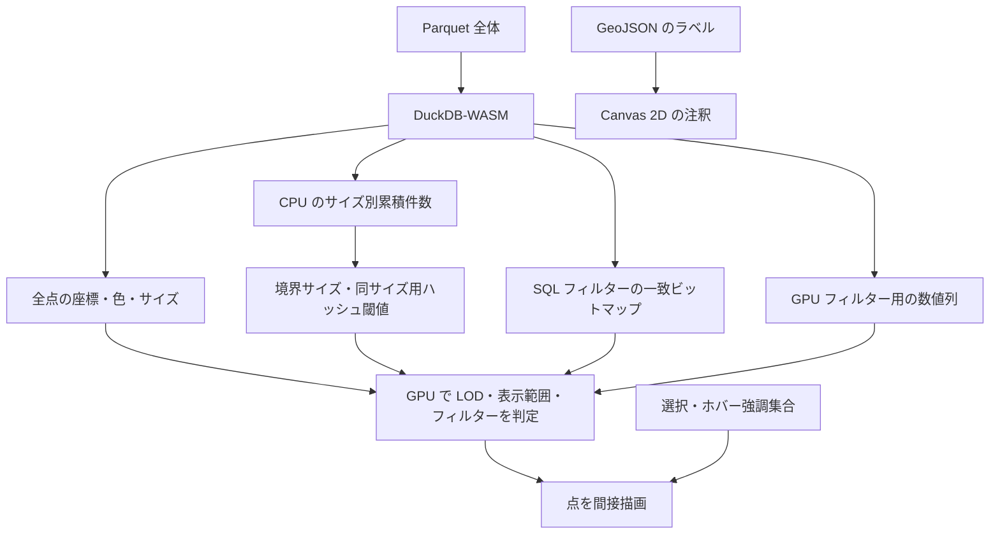

# 現行アーキテクチャ

コードを変更する際の前提と処理経路をまとめる。package version `1.22.0` の作業ツリーに対応する。[LOD ピラミッド提案](lod-pyramid-design.md)の方式は未導入。

構成図のソース: [architecture.puml](architecture.puml)。

## 責務

公開窓口の `ScatterPlot` が次の三層を調整する。座標計算やクラスタリングは利用側の責務とする（[ADR-0001](adr/0001-fixed-input-exploration.md)）。

| 層 | 現在の責務 | 主な実装 |
| --- | --- | --- |
| データ | Parquet の読み込み、SQL、描画属性の生成、ホバーと画面内一致点の空間検索 | [DataLayer](../src/data/data-layer.ts)、[ParquetReader](../src/data/repository.ts)、[SpatialPointIndex](../src/data/spatial-index.ts) |
| 点の描画 | GPU バッファ、LOD、範囲・条件判定、選択とホバー強調 | [GpuLayer](../src/renderer/gpu-layer.ts)、[WGSL](../src/renderer/shaders.ts) |
| 注釈と操作 | Canvas 2D のラベル、ホバーアウトライン、ポインター入力 | [LabelLayer](../src/ui/label-layer.ts) |

## 読み込みと点 ID

URL の Parquet も全体を取得してから、DuckDB の `parquet_data` テーブルへ読み込む。全点の座標・色・サイズは 16 bytes/point の描画用バッファへ変換する。それに加え、数値フィルター列、各種マスクと描画用インデックス、CPU の座標キャッシュと四分木、CPU のサイズ別累積件数などを保持する。16 bytes/point は総メモリ使用量ではない。

全点常駐と SQL・GPU の分担を維持する理由は [ADR-0002](adr/0002-resident-data-and-filter-paths.md) に記録する。

点本体と GPU フィルター列は `ORDER BY rowid` で取得し、内部の `rowid` と GPU バッファの添字を同一視する。`rowid` は `0..N-1` の連続した値が必要。各マスクも同じ ID を添字として使うため、初期化時の準備を含め、行集合と ID 対応の維持が前提となる。外部の業務 ID はデータ属性として扱い、点 ID と混同しない。

`dataFile` が指定されていれば `dataUrl` より優先する。`onDatabaseReady` はテーブル読み込み後、描画用データを生成する前に呼ばれ、派生列の準備などに使える。

`runQuery()` は任意 SQL を実行できるが、SQL 実行後に GPU バッファや空間インデックスを自動同期しない。行の追加・削除や座標変更が既存の散布図へ反映される保証はない。固定データという利用契約を SQL の解析によって強制する実装もない。

## 更新時の処理

| 変更内容 | 主な更新 |
| --- | --- |
| `sizeSql` / `colorSql` | 全点の描画属性と GPU の点バッファを更新。サイズ変更では累積件数も再集計。座標と四分木は再利用 |
| `whereConditions` | 一致する `rowid` のビットマップを SQL で再生成。点本体は再生成しない |
| `gpuFilterColumns` | 全点の指定数値列を取得し GPU に転送。最大 4 列 |
| `gpuWhereConditions` | 範囲条件とフェード設定を更新。数値列の再取得は不要 |
| パン・ズーム・目標描画時間 | uniform を更新して描画対象の判定をやり直す |
| ラベル設定 | 注釈の描画・操作設定を更新。ラベルソース指定時は読み込みも行う |

`getLastUpdatePlan()` で直近の更新経路を確認できる。GPU フィルター列の超過や未登録列への条件は警告して無視するため、`initialize()` 前に `error` イベントを購読して設定警告も観測する。

## LOD とフィルター

フィルター計算が必要なフレームでは、全点に対して compute を dispatch し、各点の LOD、表示範囲、SQL 条件のビットマップ、GPU 範囲条件を評価する。計算結果を再利用できるフレームは compute を省略する。タイルごとに走査対象を絞る仕組みはない。

LOD は `zoom <= 1` の俯瞰では、サイズ別累積件数から現在の保持率に対応する境界を CPU で求める。GPU は既存の `point.size` と比較して、境界より大きい点を残し、小さい点を落とす。同サイズだけを残りの保持率に対応する PCG ハッシュ閾値で間引く。均一サイズ・ズームイン・有効な分布がない場合は、従来の点 ID の PCG ハッシュで間引く。サイズ分布は色だけの変更では再利用し、サイズ変更・明示的な再取得・入力の差し替えで作り直す。パン・ズームでは SQL を実行しない。

サイズ分布は降順の float32 サイズと累積件数をそれぞれ 4 bytes/サイズで CPU に保持する。サイズの種類数が点数に近い場合は、この表も点数に比例して大きくなる。点ごとの `lodPriority` GPU バッファと、順位を求める SQL の window 関数は使わない。俯瞰の全体分布を部分領域へ適用すると、小さい点が集まる領域が消えるため、ズームインでは方式を切り替える（従来の理由の履歴: `787ff37`）。

サイズ優先を維持する目的とトレードオフは [ADR-0004](adr/0004-overview-size-priority.md) を参照。

`gpu.targetRenderTimeMs` は絞り込みと GPU 描画の目標時間で、既定値は 60 fps の 1 フレーム分に相当する `1000 / 60` ms（約 16.67 ms）。React サンプルはこの既定値に固定する。初期表示とデータ切替時は保持率 100% で計測を始め、0.01% から 100% までの決まった段階で調整する。直近 3 件の処理単価の中央値を平滑化し、目標の 20% 超過で下げ、上げた後も 20% の余裕が見込めるときだけ上げる。更新間隔は最低 500 ms とし、小さな時間差による段階の往復を抑える。同じ保持率の計測だけを使い、軽い描画のみのフレームでは増やさない。操作後の自動再描画は最大 96 回で停止する。初期フレームは LOD による間引きがないため、間引き後より GPU 負荷が高くなることがある。

パン・ズームの移動中は保持率を固定する。最後の移動から 200 ms 後に新しい計測で調整を再開し、移動中に始まった計測は到着が遅れても調整に使わない。遅延再描画のタイマーは新しい移動や破棄時に解除する。CPU のポイントホバーも、マウスボタンが押されている間は解除し、新しい点の問い合わせを行わない。

対応環境では `timestamp-query` を要求し、最初の絞り込みパス開始から最後の描画パス終了までを測る。計測用に 2 スロットを持ち、各スロットの解決先・読み戻し先はそれぞれ 16 bytes。使用中は上書きせず、待機で描画を止めない。非対応時や読み戻し失敗後はキュー完了までの経過時間を使い、JS 通知遅延を含む推定として区別する。CPU のラベル描画は対象外。全点の読み込み量や compute の走査件数も制限しない。方針は [ADR-0007](adr/0007-render-time-target.md) を参照。

`whereConditions` と `gpuWhereConditions` は別経路で適用する。GPU 条件はデータベースのテーブルを変更せず、`runQuery()` に両者の条件が自動挿入されることもない。集計結果をフィルター一致点に合わせる場合、利用側でクエリ条件を揃える必要がある。

`filteredPointDisplayMode: 'grayed'` では、不一致点も LOD と表示範囲を通過すれば灰色で描画する。「フィルター一致点」と「描画点」は異なる集合になる。

## 選択とホバー

選択は全点に対応する GPU の 1 bit/point マスクとして保持する。ブラシの既定対象は SQL・GPU 条件を通過した点で、LOD を通過した点だけに限定しない。描画経路は選択を CPU へ読み戻さず、件数が必要な場合に `getSelectionCount()` で非同期に取得する。

選択集合を表示条件から独立させる判断は [ADR-0003](adr/0003-selection-independent-of-drawing.md) を参照。現在の件数 API が返すのは全選択数であり、条件一致や描画によって絞った選択数ではない。

選択集合とホバー強調集合は独立する。単一点のポイントホバーと、複数点を扱うホバー強調集合も区別する。選択やホバー強調は描画段階の見た目に作用し、LOD やフィルターを迂回して点を強制描画する仕組みはない。単一点ホバーのアウトラインは別レイヤーに描くが、現状はラベルが 0 件または非表示だと描画されず、アウトラインを無効にする設定もある。

行数が変わる点バッファ更新では選択・ホバー強調集合をクリアする。同じ行数での再生成では維持するが、同じ行数なら対象の意味まで同じだと検証しているわけではない。

ポインターに最も近い点の検索は CPU の空間インデックスを使い、SQL・GPU 条件を考慮するが LOD を考慮しない。プログラムから `setPointHover(id)` を呼ぶ場合はフィルター一致も要求しない。このため、ホバー対象と描画点は一致するとは限らない。灰色を含む描画点をポインター対象にする [ADR-0005](adr/0005-hover-targets.md) は今後の変更方針であり、未実装。

## 注釈と視覚表現

`getPointsInViewport(limit)` は固定座標の四分木で画面内一致点を探索し、上限 + 1 件で打ち切る。SQL の一致ビットと、GPU と同じ f32 閾値・同じ列の最後の範囲条件を使い、LOD と alpha は考慮しない。点の中心がキャンバス内にあることを条件とし、GPU のカリング余白は含めない。候補件数は制限するが、不一致点が多い場合の四分木の走査量までは制限しない。既存の最近傍ホバーの閾値判定との差は、引き続き [未対応事項](follow-ups.md#cpu-と-gpu-の範囲判定) で扱う。

点カードの HTML は React example に置き、ライブラリ本体には候補・属性の取得と表示状態・データ更新の通知を追加する（[ADR-0008](adr/0008-point-cards-independent-of-lod.md)）。点を指すしっぽを持つ吹き出しを、現在の `size` が大きい点から配置し、同サイズでは `rowid` が小さい点を優先する。操作中はカードの位置だけを更新し、150 ms の停止後に候補としっぽを含む重なりを再判定する。`getPointsByIds()` は元の属性と現在の `sizeSql`・`colorSql` の値をひとつのクエリで取得する。取得は同時に 1 件だけ実行し、待機中の要求は最新の表示状態にまとめる。画面・フィルター・属性・散布図の寿命が変わった場合は古い応答を反映しない。

ラベルは点と独立した位置付き注釈で、点との所属関係を自動計算しない。クラスタのラベルから所属点を強調する場合などは、利用側が対応する点 ID を渡す。

任意設定の `gpu.recededClamp` は、減光した点などをオフスクリーンへ描画し、累積 alpha を制限してから合成する。密集した非注目点が不透明になるのを抑える代わりに、追加の描画パスと描画領域分の資源を使う。無効時は通常の描画経路を使う。

## 確認できている制約

- 点の描画は WebGPU を必要とする。WebGL や Canvas 2D による点描画へのフォールバックは実装されていない。
- 数十万〜数百万点を主対象とするが、対応点数やフレームレートの上限保証を裏付ける計測資料はまだない。目標描画時間の既定値を達成保証として扱わない。
- `npm test` は現在 `true` を実行するだけで、挙動の自動検証ではない。ビルド、lint、パッケージ内容の検査と、描画・操作の検証を区別する。
- `initialize()` は致命的な初期化例外をイベントへ変換し、通常は Promise を解決する。`await` の完了だけでは成功を判断できない。reject へ移行する [ADR-0006](adr/0006-initialization-failures.md) は未実装。
- GPU フィルターは float32 の近似で、CPU との丸め境界の不一致も残る。入力の有限性の検証も未実装。詳しくは [データ契約](data-contract.md) と [未対応事項](follow-ups.md) を参照。
